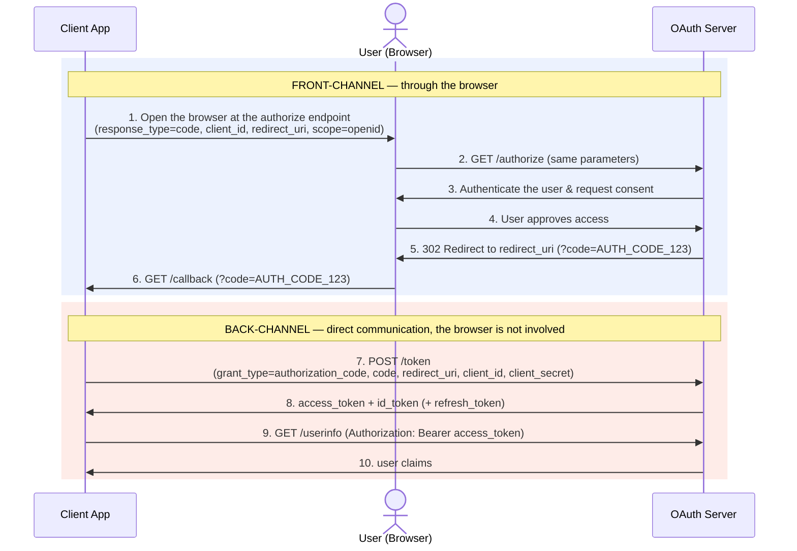

# Authorization Code Flow

The Authorization Code flow 
([RFC 6749, §4.1](https://www.rfc-editor.org/info/rfc6749/#section-4.1)) is the 
standard OAuth 2.0 flow for confidential clients, and the one our Rust 
application falls back to whenever no valid refresh token is available. Because 
our client requests only the `openid` scope, this same flow doubles as an 
OpenID Connect *authentication* request: in return for the access token it also 
receives an identity token (`id_token`) describing who just signed in. It is 
best understood as two phases, separated by the *channel* each message travels 
over:

The flow starts when our Client App builds an *authorization request* and opens
the user's browser at the identity provider **authorize endpoint**, carrying
four core orchestration parameters: `response_type=code` (asking for an
authorization code), `client_id` (who is asking), `redirect_uri` (where to send
the answer), and `scope=openid` (the OpenID Connect signal that we are
authenticating the user and, in return, want an identity token plus an access
token for the `/userinfo` endpoint) — step 1.

The browser carries that request to the OAuth Server (step 2), which
authenticates the user and asks for consent (steps 3–4). On approval, the server
redirects the browser *back* to the `redirect_uri`, appending the authorization
`code` to the query string (step 5). The browser dutifully follows that redirect
and hits our ephemeral `/callback` endpoint with `?code=AUTH_CODE_123` (step 6).

At this point the Client App holds the authorization `code` but no tokens yet.
It exchanges the code for tokens by POSTing directly to the provider's **token
endpoint**, this time sending `grant_type=authorization_code`, the `code`, the
`redirect_uri`, and — because we are a *confidential* client — the `client_id`
and `client_secret` (step 7). The OAuth Server validates the request and 
responds with the two tokens we asked for (step 8): an `access_token` — the 
bearer credential used to call protected endpoints such as `/userinfo` — and an
`id_token`, a signed JSON Web Token that asserts who just authenticated.
Providers may additionally return a `refresh_token` for later re-use.

To read the authenticated user's profile, the client finally presents that
`access_token` to the provider's **userinfo endpoint** (step 9), which answers
with the user's claims (step 10). The `id_token` already carries the core
identity (its `sub` claim), while `/userinfo` can supply richer, up-to-date
profile attributes.

## Scopes
...
