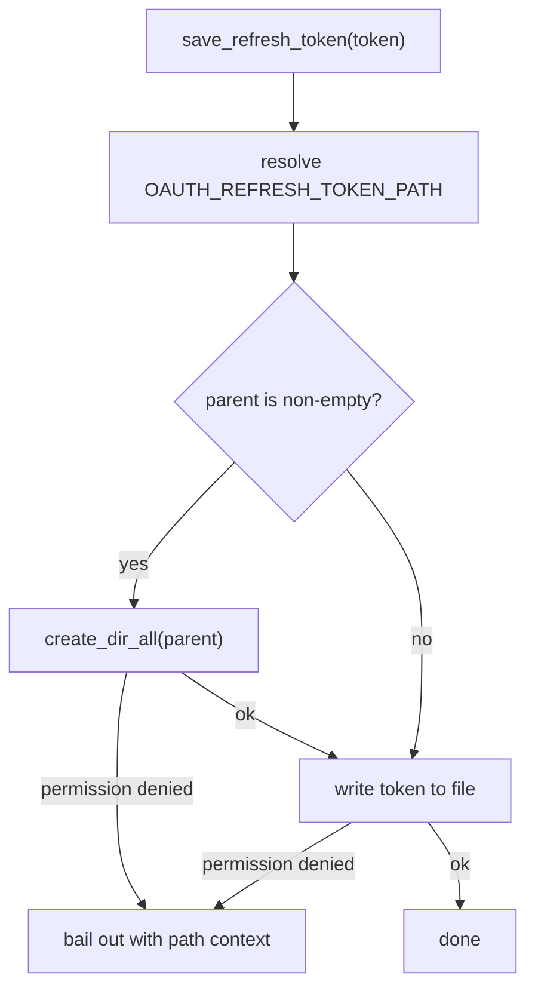

{{#include warning.md}}

# Refreshing an Access Token

The access token handed out by the *Authorization Code Grant* is short-lived.
When the provider also issues a `refresh_token`, our client can trade that
long-lived credential for a fresh access token without sending the user
through the browser again
(see [RFC 6749, §6](https://www.rfc-editor.org/info/rfc6749/#section-6)).

To make that possible across process restarts, the client persists the refresh
token to a local file and loads it back on the next run. Only when that file
is missing — or the provider rejects the token — does the client fall back to
the full browser flow.

## Where the token is stored

Making the location configurable lets the same binary run unchanged on a
laptop, in a container, or on a server:

- **`OAUTH_REFRESH_TOKEN_PATH`**  
  the environment variable naming the storage path; it may be either an
  absolute or a relative path, and a relative path is resolved against the
  current working directory.


- **`.refresh-token`**  
  the default used when the variable is not set, so the client still works
  out of the box.


```sh
# An absolute path, e.g. inside a writable system directory
OAUTH_REFRESH_TOKEN_PATH=/var/lib/oauth2-client/refresh-token

# A nested relative path, resolved against the working directory
OAUTH_REFRESH_TOKEN_PATH=.secrets/refresh-token
```

The token is a secret, so the default file is listed in `.gitignore` and must
never be committed. Following the _12-Factor App_ advice, the setting still
arrives through the environment; the `config` module reads it once and exposes
it to the rest of the program.

```rust
// file: src/config.rs
// -------------------

pub struct AppConfig {
    pub issuer_url: String,
    pub issuer_type: IssuerType,
    pub client_id: String,
    pub client_secret: String,
    pub scopes: Vec<String>,
    pub refresh_token_path: PathBuf,
}

/// Fallback location, used when `OAUTH_REFRESH_TOKEN_PATH` is not set.
const DEFAULT_REFRESH_TOKEN_PATH: &str = ".refresh-token";

// ... inside `load()` ...

// Unlike the settings above, this one is optional: it silently falls
// back to the default so the client keeps working out of the box.
let refresh_token_path = PathBuf::from(
    dotenvy::var("OAUTH_REFRESH_TOKEN_PATH")
        .unwrap_or_else(|_| DEFAULT_REFRESH_TOKEN_PATH.to_string()),
);
```

## The `store` module

A dedicated `store` module isolates the two filesystem operations behind a
small API, so the rest of the code never deals with paths directly. Both
functions resolve the path from the global configuration and attach the
offending path to any error they propagate.

```rust
// file: src/store.rs
// ------------------

use anyhow::{Context, Result};
use std::path::PathBuf;
use tokio::fs;

use crate::config;

fn refresh_token_path() -> PathBuf {
    config::get().refresh_token_path.clone()
}
```

Loading is deliberately forgiving: a missing or empty file is not an error, it
simply means the client has not stored a token yet, and the caller should run
the Authorization Code flow instead.

```rust
// file: src/store.rs
// ------------------

pub async fn load_refresh_token() -> Result<Option<String>> {
    let path = refresh_token_path();

    if !fs::try_exists(&path).await.with_context(|| {
        format!("failed to check refresh token file {}", path.display())
    })? {
        return Ok(None);
    }

    let token = fs::read_to_string(&path).await.with_context(|| {
        format!("failed to read refresh token file {}", path.display())
    })?;

    let token = token.trim().to_string();
    if token.is_empty() {
        Ok(None)
    } else {
        Ok(Some(token))
    }
}
```

Saving is the more interesting half. Before writing, the client creates every
missing intermediate directory so that a deep absolute path such as
`/var/lib/oauth2-client/refresh-token` works on the very first run.

```rust
// file: src/store.rs
// ------------------

pub async fn save_refresh_token(refresh_token: &str) -> Result<()> {
    let path = refresh_token_path();

    // Create all missing parent components. A bare filename such as
    // `.refresh-token` has an empty parent, which `create_dir_all`
    // rejects, so skip it and write into the working directory.
    if let Some(parent) =
        path.parent().filter(|p| !p.as_os_str().is_empty())
    {
        fs::create_dir_all(parent).await.with_context(|| {
            format!(
                "failed to create directory {} for refresh token",
                parent.display()
            )
        })?;
    }

    fs::write(&path, refresh_token).await.with_context(|| {
        format!("failed to write refresh token to {}", path.display())
    })?;

    Ok(())
}
```

## Putting it together



The two failure modes the client refuses to swallow are called out explicitly:

- **Directory creation denied**  
  a read-only parent or a path the process may not traverse aborts the run
  with a message naming the directory.


- **Write denied**  
  a missing write permission on the target file aborts the run with a message
  naming the file.


In both cases the error is enriched with `.with_context(...)` and bubbles up
to `main`, which logs it and exits with a non-zero status — no token is
silently dropped.
